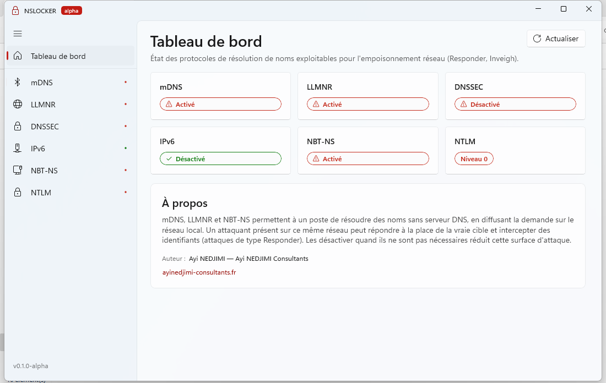
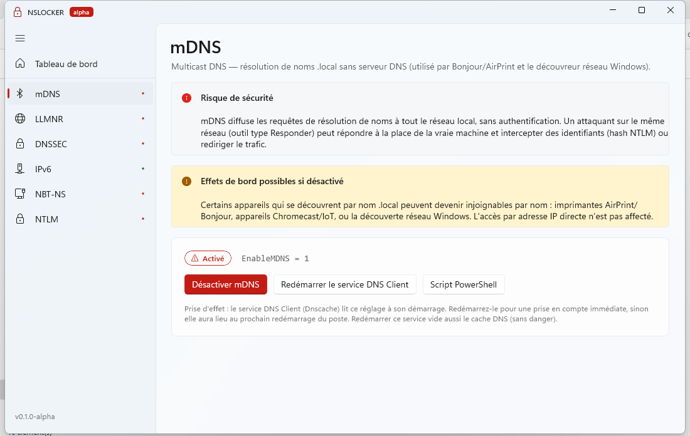
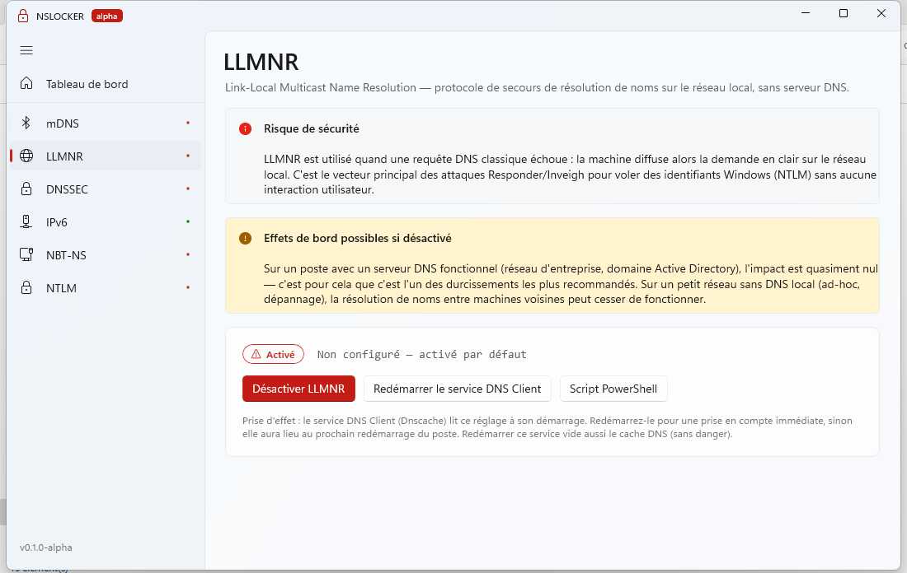
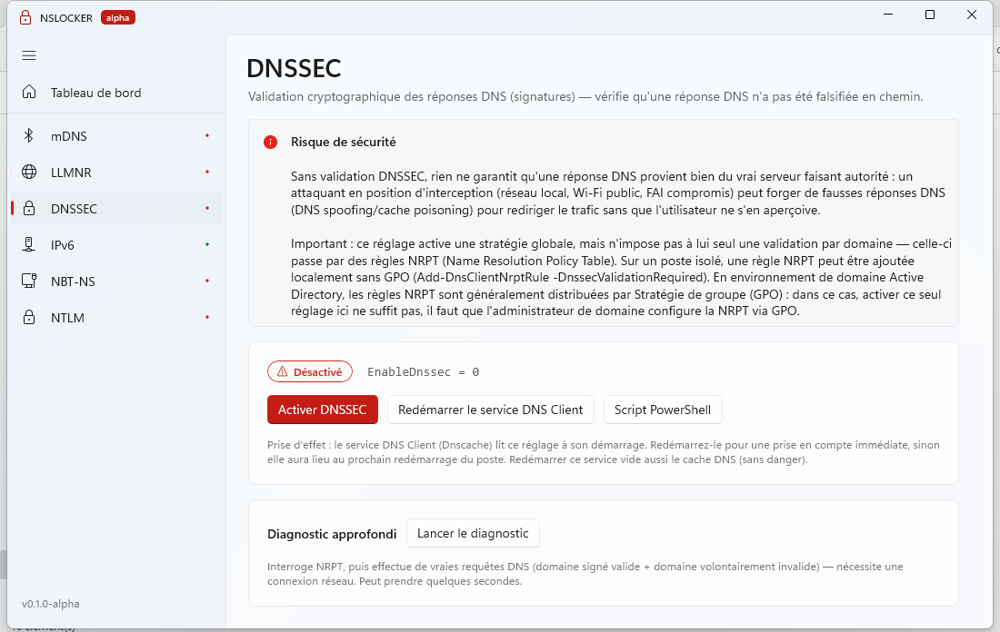
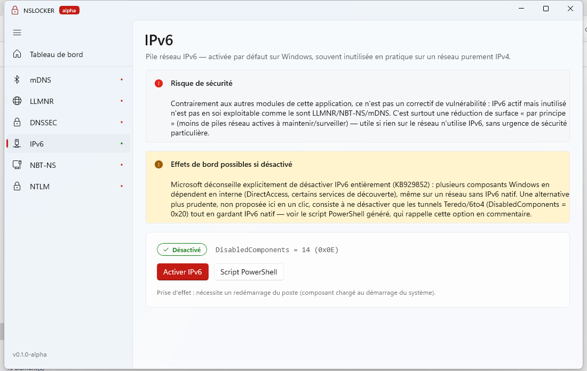
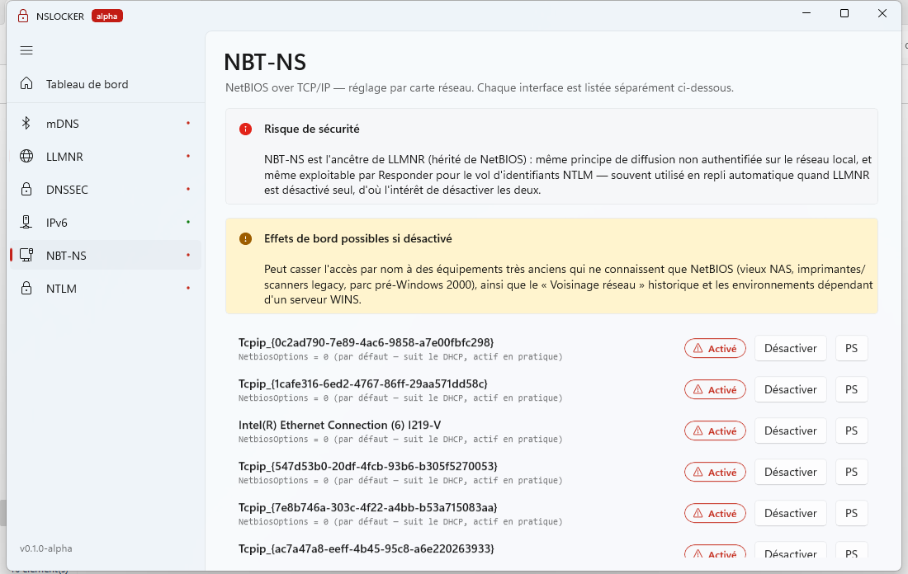
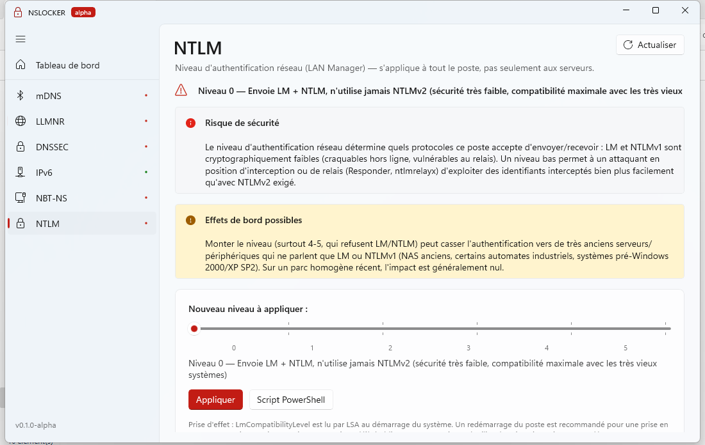

<p align="center"></p>

<p align="center">
  
  
  
  
  
</p>

**NSLOCKER** est une application Windows portable qui affiche l'état des protocoles de résolution de noms exploitables pour l'empoisonnement réseau (attaques de type Responder / Inveigh) et permet de les durcir en un clic.

## Captures d'écran

<table>
  <tr>
    <td></td>
    <td></td>
  </tr>
  <tr>
    <td></td>
    <td></td>
  </tr>
  <tr>
    <td></td>
    <td></td>
  </tr>
  <tr>
    <td></td>
    <td></td>
  </tr>
</table>

## Protocoles gérés

| Protocole | Risque |
|---|---|
| mDNS | Résolution par diffusion multicast : un attaquant du même réseau peut répondre à la place de la cible. |
| LLMNR | Idem : permet de capturer des identifiants (Responder). |
| NBT-NS | Résolution NetBIOS par diffusion : même risque d'usurpation. |
| DNSSEC | Sans validation, une réponse DNS falsifiée n'est pas détectée. |
| IPv6 | Peut être exploité (ex. faux serveur DHCPv6/RA) quand il n'est pas utilisé. |
| NTLM | Les niveaux d'authentification faibles exposent les identifiants. |

## Prérequis

- Windows 10 1809+ / Windows Server 2019+ avec interface graphique, x64.
- **Droits administrateur** (manifest `requireAdministrator`).
- L'exe n'est pas signé : Windows SmartScreen peut afficher un avertissement.

## Effets de bord

- Le redémarrage du service Dnscache vide le cache DNS.
- NBT-NS, IPv6 et NTLM nécessitent un redémarrage du poste.
- Un niveau NTLM 4-5 et la désactivation d'IPv6 peuvent casser des équipements ou applications anciens. Testez d'abord sur une machine non critique.
- Les réglages sont écrits dans le registre (HKLM).

## Utilisation

Téléchargez depuis les [Releases](../../releases) soit `NSLOCKER.exe` (portable), soit `NSLOCKER-Setup-0.1.0-alpha.exe` (installeur Inno Setup). Vérifiez le SHA256 (`SHA256SUMS.txt`), puis lancez en administrateur. L'exe fait environ 85 Mio (89 602 980 octets pour la v0.1.0-alpha).

## Compilation

```powershell
dotnet build -c Release -p:Platform=x64
dotnet publish -c Release -r win-x64 -p:Platform=x64
```

Pour recompiler l'installeur : `ISCC installer\NSLOCKER.iss` (Inno Setup 6, après `dotnet publish`).

## Licence

MIT, voir [LICENSE](LICENSE). Composants tiers : [THIRD_PARTY_NOTICES.md](THIRD_PARTY_NOTICES.md).

Auteur : Ayi NEDJIMI Consultants, https://ayinedjimi-consultants.fr
